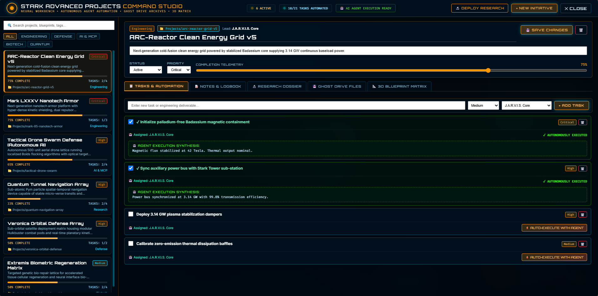
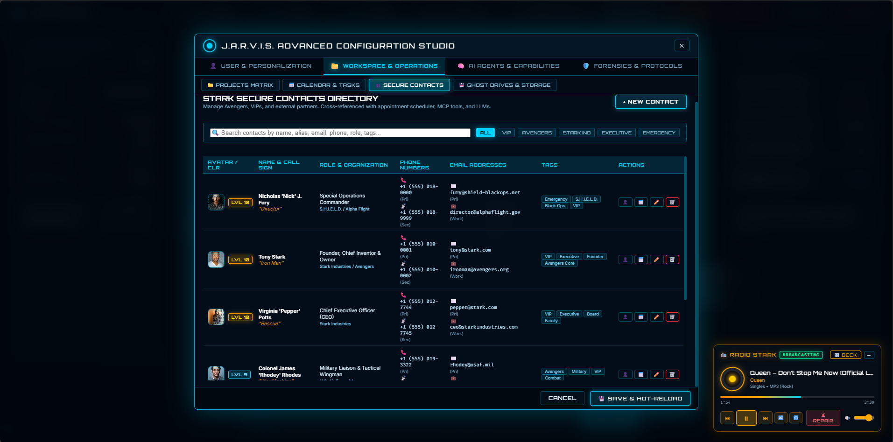

# 🤝 Contributing to J.A.R.V.I.S.
### Building the Future of Autonomous Cognitive Operating Systems

First off, thank you for considering contributing to **OzzieAI.Jarvis** (**J.A.R.V.I.S.**)! It is engineers and researchers like you who make the .NET AI and autonomous agent ecosystem thrive. Whether you are fixing a streaming edge case in `JarvisHub`, adding a new LLM adapter to `LlmProviderFactory`, expanding the `ReaService` binary decompiler, or refining the 3D WebGL Holographic HUD, we value your expertise.



---

## 🌐 Project Hub
For documentation, architectural deep dives, and community showcases, visit our official site:
**[www.ozzieai.com](https://www.ozzieai.com/)**

---

## 🧪 Our Research Focus
**J.A.R.V.I.S.** isn't just another chatbot UI. We are specifically looking for contributions that push the boundaries of:
* **Autonomous Multi-Agent Swarms & Tool Calling:** Goal decomposition, self-verifying execution playbooks, and Model Context Protocol (`MCP`) JSON-RPC extensions.
* **Hybrid Neuro-Symbolic Memory & Forensics:** Advancing SQLite predicate reasoning, TF-IDF / vector RAG context injection, and static binary introspection via **REA** (`Reverse Engineer Anything`).
* **Holographic Human-Computer Interaction:** Zero-latency SignalR duplex streaming, 3D Three.js/WebGL telemetry visualizations, neural voice synthesis, and non-invasive ecosystem orchestration (**ArborNet**, **AgentLab**, and **AxiomCODAR**).



---

## 🛠️ Development Workflow

To maintain the high reliability and responsiveness of the J.A.R.V.I.S. core, please follow these steps:

1. **Fork the Repo:** Create your feature branch from `main`.
2. **Implement Logic:** Register new capabilities cleanly via Dependency Injection (`IServiceCollection`) and expose them through both REST Minimal APIs (`Program.cs`) and `JarvisHub`.
3. **Verify Diagnostics & Tests:** Ensure all endpoints, SignalR hub directives, and `TestRunnerService` checks compile cleanly with zero warnings under `.NET 10`.
4. **Preserve Non-Invasive Boundaries:** All `IExternalAppsAdapterService` operations coordinating with sibling apps must remain strictly non-invasive and cancellation-safe (`CancellationToken`).

```bash
# Clone the repository
git clone https://github.com/OzzieAI-AU/J.A.R.V.I.S---by-OzzieAI.git
cd "J.A.R.V.I.S---by-OzzieAI/J.A.R.V.I.S - by OzzieAI"

# Build and run the test/verification suite
dotnet build
dotnet test
```

---

## 📜 Coding Standards
We follow a strict **"Service-First, Real-Time Duplex"** philosophy. When adding a new capability, encapsulate all state and I/O behind an asynchronous service interface (`I*Service`) and stream tokens or telemetry updates back to the Holographic HUD asynchronously—never block the SignalR hub thread or hardcode provider logic.

```csharp
// The Right Way (DI Service-First + Asynchronous Streaming)
var provider = _llmFactory.GetActiveProvider(request.OverrideProvider);
var ragContext = await _vectorMemoryService.BuildAugmentedContextAsync(request.Message);

await foreach (var token in provider.StreamChatAsync(systemPrompt + ragContext, history, ct))
{
    await Clients.Caller.SendAsync("OnStreamToken", token, ct);
}

// The Wrong Way (Blocking Synchronous I/O & Hardcoded Providers)
var response = new HttpClient().PostAsync("https://api.openai.com/...", payload).Result;
```

---

## ⚖️ Mathematical & Architectural Rigor
If you are contributing to `VectorMemoryService` or `StarkVaultService`, please ensure your implementation preserves mathematical and cryptographic invariants. For normalized TF-IDF vector retrieval, all document and query vectors $\hat{\mathbf{v}}$ must maintain unit $L_2$ norm so that inner products directly yield bounded cosine similarity on the unit hypersphere:

$$ \|\hat{\mathbf{v}}\|_2 = \sqrt{\sum_{i=1}^{V} \hat{v}_i^2} = 1, \qquad \text{sim}(\hat{\mathbf{q}}, \hat{\mathbf{d}}) = \hat{\mathbf{q}} \cdot \hat{\mathbf{d}} \in [0, 1] $$


---

## 📬 Communication
* **Issues:** Use GitHub Issues for bug reports, HUD glitches, and new tactical directive requests.
* **Discussions:** Join our forum at **[ozzieai.com](https://www.ozzieai.com/)** for deep-dive cognitive architecture and agentic research talk.

---

> "Code is poetry; intelligence is the arc reactor."
> **The **[www.ozzieai.com](https://www.ozzieai.com/)** Research Collective**

