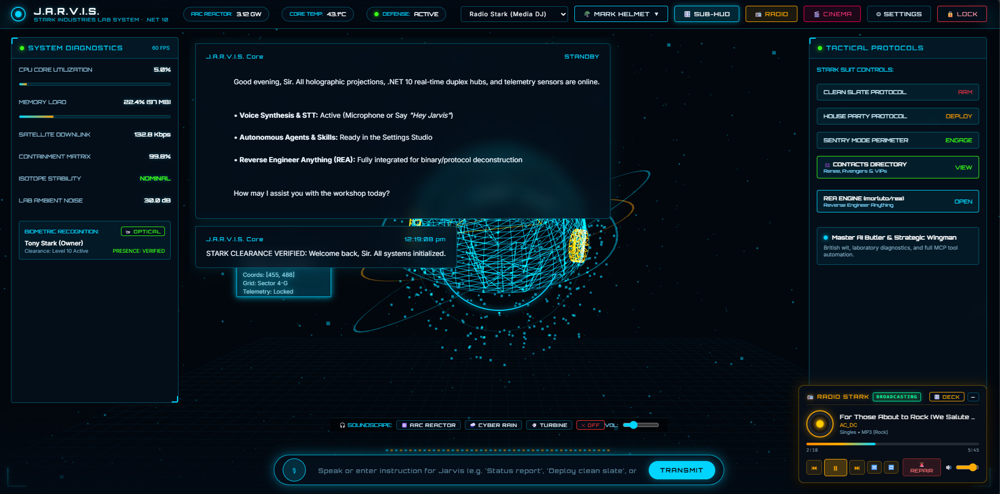
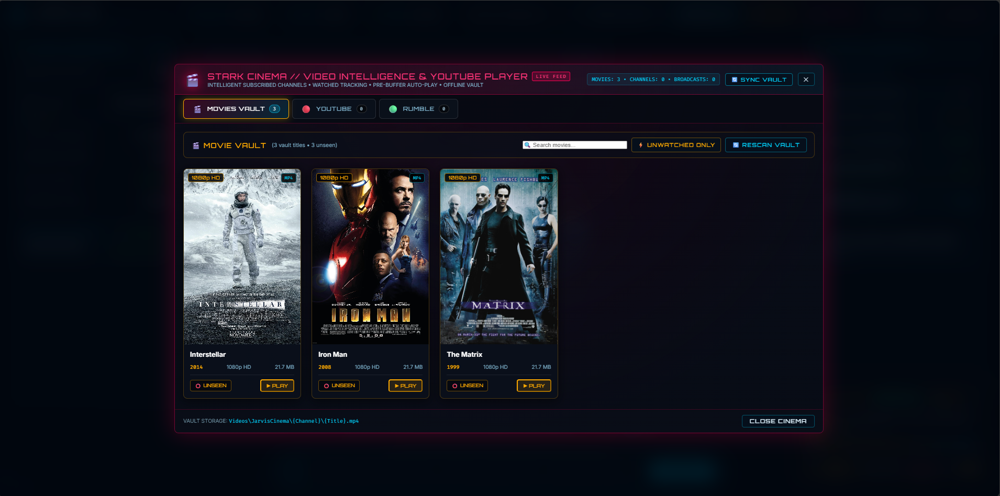
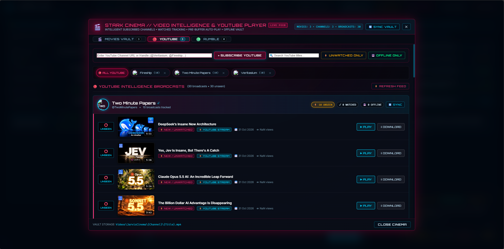

# 🤖 J.A.R.V.I.S. — Just A Rather Very Intelligent System
### The Holographic .NET 10 Autonomous AI Operating System & Cognitive Command Matrix


**OzzieAI.Jarvis** (**J.A.R.V.I.S.**) is a high-performance, full-spectrum autonomous AI operating system and holographic command center built natively on **.NET 10**, **ASP.NET Core SignalR**, **SQLite**, and a **3D WebGL / Three.js Holographic HUD**. Engineered for researchers, developers, and power users who demand more than a static chat box, J.A.R.V.I.S. unifies multi-provider LLM orchestration, persistent semantic memory, autonomous background scheduling, binary reverse engineering, hardware telemetry, media harvesting, and cross-application ecosystem control into a single sentient workspace.

> ### 💡 The J.A.R.V.I.S. Advantage
> While conventional AI wrappers trap intelligence inside isolated browser tabs, OzzieAI's **J.A.R.V.I.S.** operates as a true desktop-and-web cognitive nervous system—bridging six frontier LLM engines, local Whisper speech recognition, hardware-encrypted secret vaults, and direct orchestration of the OzzieAI software suite (**ArborNet**, **AgentLab**, and **AxiomCODAR**) with sub-millisecond responsiveness.



---

## ✨ Why J.A.R.V.I.S.?

Most AI assistants feel like stateless text prompts. **J.A.R.V.I.S.** feels like stepping into Tony Stark's workshop.

- **⚡ Multi-Provider Neural Routing:** Seamlessly hot-swap between **OpenAI**, **Anthropic Claude**, **Google Gemini**, **Groq**, **DeepSeek**, and local **Ollama** models on the fly via `LlmProviderFactory`.
- **🌀 3D WebGL Holographic HUD:** Interactive Three.js neural core, dynamic telemetry rings, customizable HUD color themes, ambient sound effects (`sfx.js`), and a borderless desktop overlay mode (`overlay.html`).
- **💎 Duplex SignalR Telemetry & Voice:** Real-time bi-directional streaming (`/hub/jarvis`), neural TTS synthesis, local **Whisper** speech-to-text (`LocalWhisperService`), and continuous meeting transcription (`MeetingEarService`).
- **🛠️ Full-Spectrum Autonomous Agency:** Built-in multi-agent swarm deployment, natural-language task scheduling, sandboxed script execution, Docker & GitOps management, and live OS window/clipboard sentinels.

---

## 🧠 Introducing the Stark Neural Core: The v1.0 Cognitive Command Engine

At the heart of **OzzieAI.Jarvis** is a deeply integrated neuro-symbolic command architecture (`JarvisHub` + 35+ specialized singleton microservices). Powered by native C# **.NET 10**, **SQLite** relational persistence, **TF-IDF Cosine Vector RAG**, and a **Model Context Protocol (MCP)** JSON-RPC bridge, J.A.R.V.I.S. acts as an always-on, self-monitoring engineering co-pilot.

> ### ⚡ Why the J.A.R.V.I.S. Core Wins
> By combining deterministic intent routing in `JarvisHub` with asynchronous background hosted services (`JarvisSchedulerService` and `McpSensorService`), J.A.R.V.I.S. executes system diagnostics, reverse-engineers compiled `.dll`/PE/ELF binaries via **REA**, indexes project codebases, and coordinates sibling AI applications with **zero container overhead**.

---

### 🏛️ The Four Core Pillars of J.A.R.V.I.S.

1. **Real-Time SignalR Neural Duplex & 3D WebGL HUD:** Built on an ultra-low-latency ASP.NET Core SignalR pipeline supporting 10MB+ multimodal payloads for real-time token streaming, live Arc Reactor & host hardware telemetry, and full-screen holographic vision analysis (`/api/vision/screen`).
2. **Hybrid Semantic Memory (SQLite Predicates + Vector RAG):** Combines structured persistent fact storage (`PredicateService`) with an in-memory normalized TF-IDF vector engine (`VectorMemoryService`) that automatically warms up from SQLite and injects high-relevance contextual dossiers into every LLM prompt.
3. **Autonomous Multi-Agent Swarm, Tactical Tools & REA Engine:** Features dynamic persona switching (`AgentService`), multi-agent goal decomposition (`AgentSwarmService`), a 3D Project Matrix (`ProjectService`), and a native **Reverse Engineer Anything (`ReaService`)** engine that inspects `.NET` metadata headers (`BSJB`), PE/ELF/Mach-O binaries, SHA-256 hashes, and decompiled method signatures.
4. **1000x External Ecosystem Orchestration & Stark Media Matrix:** Non-invasively inspects, builds, tests, benchmarks, and launches sibling OzzieAI platforms—**ArborNet & NedK-Prime**, **AgentLab (AutoLab Bench Pro)**, and **AxiomCODAR (Roslyn AST Studio)**—while providing an autonomous **Stark Radio Station**, **YouTube/Rumble Cinema Player**, and **Stark Movie Vault** with byte-range streaming.

---

### 📊 J.A.R.V.I.S. vs. Traditional AI Assistants

| Subsystem | Traditional Web / Python AI Wrappers | The OzzieAI J.A.R.V.I.S. Advantage |
| :--- | :--- | :--- |
| **Runtime & Footprint** | Heavy Python virtualenvs, Docker containers, and fragmented Node.js frontends | **Single Native .NET 10 Web/Host Binary** with zero-dependency embedded SQLite & vanilla ES6/WebGL. |
| **Memory & Personalization** | Ephemeral session history or slow external vector DB clusters | **Dual-Layer Memory**: Instant SQLite Predicates (`remember X = Y`) + automated Cosine Vector RAG warmup. |
| **OS & Developer Tooling** | Isolated text generation with no host awareness | **35+ Native Services**: REA binary decompiler, Code Sandbox, Docker/GitOps, Network ARP Radar, Serial Bridge, and Terminal Sentinel. |
| **Ecosystem Orchestration** | Manual CLI switching between ML frameworks and IDEs | **1000x External Apps Adapter** controlling **ArborNet**, **AgentLab**, and **AxiomCODAR** via voice or REST. |
| **Security & Secrets** | Plaintext `.env` files exposed across directories | **Stark Vault (`StarkVaultService`)** featuring AES-256 encryption, SHA-256 key derivation, and Level-10 passcode gates. |

---

## 🚀 Get Started in Seconds

**OzzieAI.Jarvis** exposes a clean **SignalR Neural Hub**, a comprehensive **27-group RESTful Minimal API**, and natural-language **Tactical Directives** right out of the box.

```csharp
// 1. Hot-swap LLM providers dynamically via LlmProviderFactory
var provider = llmFactory.GetActiveProvider(overrideProvider: "Claude"); // OpenAI, Claude, Gemini, Groq, DeepSeek, Ollama
await foreach (var token in provider.StreamChatAsync(systemPrompt, chatHistory, cancellationToken))
{
    await Clients.Caller.SendAsync("OnStreamToken", token);
}

// 2. Augment prompts with Vector RAG & Persistent SQLite Predicates
await predicateService.SavePredicateAsync(new PredicateItem
{
    Key = "Suit",
    Value = "Mark LXXXV (85)",
    Category = "Engineering"
});
var ragContext = await vectorMemoryService.BuildAugmentedContextAsync("What suit configuration is active?");

// 3. Reverse-engineer any .NET assembly or native binary with REA
var reaReport = await reaService.AnalyzeTargetAsync(@"bin\Debug\net10.0\OzzieAI.Jarvis.dll");
Console.WriteLine(reaReport.SummaryMarkdown); // Outputs SHA-256, BSJB metadata, exported classes & method signatures

// 4. Orchestrate the OzzieAI Ecosystem (ArborNet, AgentLab, AxiomCODAR) via voice or code
var benchmark = await externalApps.ExecuteArborNetActionAsync("benchmark");
var astReport = await externalApps.ExecuteAxiomCodarActionAsync("ast_inspect");
var voiceRes  = await externalApps.ProcessVoiceDirectiveAsync("Jarvis, run ArborNet tensor benchmarks");
```

### 🎙️ Instant Natural-Language Tactical Directives
Type or speak any of these directly into the J.A.R.V.I.S. Holographic HUD:
- `"diagnostics"` / `"specs"` — Live host CPU, RAM, disk telemetry, .NET 10 runtime, and Arc Reactor output.
- `"remember Project = Mark 85"` / `"predicates"` — Persist or query facts in the SQLite neural database.
- `"Create an Appointment for tomorrow at 10AM with Pepper"` — Cross-references the Stark Contacts Directory & arms recurring alarms.
- `"Create an Agent to research AI and run it 7 times a day"` — Spawns an autonomous persona & schedules background execution.
- `"rea analyze"` — Decompiles and maps assembly symbols, methods, and endpoints.
- `"Jarvis, play AC/DC"` / `"play jazz"` — Harvests master audio tracks and streams via the Stark Radio Station.
- `"clean slate protocol"` / `"house party protocol"` / `"sentry mode"` — Engages tactical defense subroutines.

---

## 🔬 Front-Line Research: Cognitive Resonance & Vector-Predicate Memory

J.A.R.V.I.S. isn't just an interface; it's a cognitive architecture for **Persistent Human-AI Symbiosis**. To eliminate context amnesia and LLM hallucinations across long-horizon engineering projects, J.A.R.V.I.S. fuses deterministic relational predicates with normalized TF-IDF vector retrieval.

For every incoming query vector $\mathbf{q}$ and indexed memory document vector $\mathbf{d}_i$ in $\mathbb{R}^V$, `VectorMemoryService` normalizes term frequencies over L2 norms and evaluates relevance via cosine similarity:

$$\text{sim}(\mathbf{q}, \mathbf{d}_i) = \frac{\mathbf{q} \cdot \mathbf{d}_i}{\|\mathbf{q}\|_2 \, \|\mathbf{d}_i\|_2} = \sum_{t \in V} \hat{w}_{t, \mathbf{q}} \, \hat{w}_{t, \mathbf{d}_i} > \tau$$

where each weight is normalized via $\hat{w}_t = f_t / \sqrt{\sum_k f_k^2}$ and filtered against a semantic activation threshold $\tau = 0.05$. Simultaneously, sensitive credentials in `StarkVaultService` are protected under AES-256-CBC with SHA-256 entropy key derivation:

$$\mathbf{C} = \text{IV} \;\Vert\; \text{AES}_{256}\!\left(\mathbf{P},\; \text{SHA256}(\mathbf{K}_{\text{Stark}}),\; \text{IV}\right)$$

By uniting vector retrieval, relational predicates, and cryptographic isolation, J.A.R.V.I.S. guarantees:

1. **Deterministic Fact Grounding:** Critical user preferences, clearance levels, and project states never drift out of the context window.
2. **Zero-Trust Local Sovereignty:** All databases (`jarvis_data.db`), Ghost Drive virtual partitions (`MARK-ARCHIVE`, `PROJECTS`, `STARK-VAULT`), and voice transcripts remain 100% under local host control.



---

## 🏗️ Architectural Excellence

**OzzieAI.Jarvis** is engineered around a modular dependency-injected service mesh. Every capability is exposed uniformly across **SignalR**, **REST APIs**, and the **Model Context Protocol (`/api/mcp/rpc`)**.

| Subsystem Layer | Core Services | Capabilities & Protocols | Status |
| :--- | :--- | :--- | :---: |
| **LLM Intelligence** | `LlmProviderFactory`, 6 Provider Adapters | OpenAI, Claude, Gemini, Groq, DeepSeek, Ollama streaming | ✅ |
| **Memory & Storage** | `JarvisDatabase`, `PredicateService`, `VectorMemoryService`, `GhostDriveService`, `BackupService` | SQLite persistence, Vector RAG, Ghost Drives, Zip Snapshots | ✅ |
| **Agency & Projects** | `AgentService`, `AgentSwarmService`, `SkillService`, `ProjectService`, `JarvisSchedulerService` | Multi-agent swarms, 3D Project Matrix, Cron/Interval Scheduler | ✅ |
| **Security & Forensics** | `AuthService`, `StarkVaultService`, `ReaService`, `NetworkRadarService`, `TerminalSentinelService` | JWT Auth, AES-256 Vault, REA Binary Decompiler, ARP Radar | ✅ |
| **Developer & OS Tools** | `ToolService`, `CodeSandboxService`, `DockerManagerService`, `GitOpsService`, `McpClientManagerService` | Polyglot Sandbox, Docker, GitOps, SQL Explorer, MCP RPC | ✅ |
| **Voice, Vision & Media** | `VoiceService`, `LocalWhisperService`, `MeetingEarService`, `StarkRadioService`, `VideoPlayerService`, `MovieVaultService` | Neural TTS, Whisper STT, YouTube/Rumble Cinema, Radio & Movie Vault | ✅ |
| **Ecosystem Bridge** | `ExternalAppsAdapterService` | Non-invasive voice & REST control of **ArborNet**, **AgentLab**, and **AxiomCODAR** | ✅ |



---

## 📥 Installation & Dependencies

Clone the repository and launch the holographic command center with the **.NET 10 SDK**:

```bash
# Clone the J.A.R.V.I.S. repository
git clone https://github.com/OzzieAI-AU/J.A.R.V.I.S---by-OzzieAI.git
cd "J.A.R.V.I.S---by-OzzieAI/J.A.R.V.I.S - by OzzieAI"

# Restore NuGet dependencies and build
dotnet restore
dotnet build

# Launch the J.A.R.V.I.S. Holographic Server & WebGL HUD
dotnet run
```

Core NuGet packages used by `OzzieAI.Jarvis.csproj`:

```bash
dotnet add package Microsoft.Data.Sqlite --version 10.0.14
dotnet add package System.IdentityModel.Tokens.Jwt --version 8.23.0
```

> **Note on Ecosystem Integration:** When placed in the sibling `OzzieAI Code` workspace alongside **ArborNet**, **AgentLab**, and **AxiomCODAR**, `ExternalAppsAdapterService` automatically detects and links all four platforms with zero configuration required.

---

## 🗺️ Future Technical Roadmap

To push **J.A.R.V.I.S.** further toward autonomous workstation singularity, our active engineering roadmap includes:

1. **NedK-Prime & Faiss.Sharp Vector Memory Acceleration:** Upgrading `VectorMemoryService` with native `Faiss.Sharp` (`IndexFlatIP`) bindings from **ArborNet** to scale local RAG memory from thousands to millions of code and document embeddings with sub-millisecond recall.
2. **Real-Time WebRTC & Wake-Word Audio Pipeline:** Expanding `LocalWhisperService` and `MeetingEarService` with always-on, zero-latency hardware wake-word detection (`"Hey Jarvis"`) and full-duplex WebRTC audio streaming.
3. **Autonomous Cross-Repo Refactoring Swarms:** Connecting `AgentSwarmService` directly with **AxiomCODAR**'s Roslyn AST syntax rewriters and `TestRunnerService` for self-healing, test-verified multi-repository code synthesis.

---

## 🤝 Contributing

We love wit, grit, and great engineering. If you’re passionate about autonomous AI operating systems, holographic interfaces, or making .NET the premier ecosystem for cognitive computing, join us. Check out our **[`Contributing.md`](Contributing.md)** to get started.

---

> "At your service, Sir—simplifying the complex, one directive at a time."  
> **Built with ❤️ by the [www.ozzieai.com](https://www.ozzieai.com/) Research Collective.**

